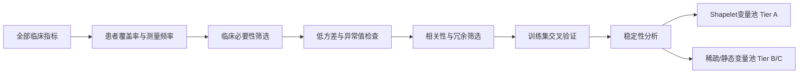

# 10 — 可信数据底座与变量筛选协议

> **状态**: 正式研究方案 v1.1（2026-08-04）  
> **效力**: 本文件优先于旧版 `02/03/06/07` 中与本协议冲突的表述  
> **MIMIC 路径**（已验证 Python 可读）:  
> `<MIMIC_DIR>`  
> （父路径名含 `.zip`，实为已解压目录；内含 `ADMISSIONS.csv.gz` 等）

---

## 0. 当前事实基线（磁盘审计）

### 0.1 两套队列并存（版本未统一）

| 版本 | 来源 | ICU stays | 患者 | 死亡率 | 备注 |
|------|------|-----------|------|--------|------|
| **Raw（较新）** | `data/raw/aki_cohort.parquet` | **9,386** | **7,925** | **21.6%** | 年龄均值 **66.1**；男性 **58.6%** |
| **Processed（较旧）** | `unified` / `engineered` / Shapelet | **10,314** | **8,559** | **21.8%** | 与 raw 仅约 **4,100** 个 `ICUSTAY_ID` 重合 |

**结论**: 任何“当前队列规模”必须标明版本。在未固定唯一版本并重跑前，**不以 processed 结果作为可发表数字**。

### 0.2 Processed 侧已生成结果（仅作历史对照，非权威）

| 产物 | 数值 |
|------|------|
| `engineered_features.parquet` | 1,984,540 行 $\times$ 168 列 |
| Shapelet 划分 | train/val/test = **6,188 / 2,063 / 2,063**（按 stay 随机，非 subject） |
| Shapelet 时序变量 | **47**（非文档中写的 64） |
| 前 24h HistGBM | train AUROC **0.9354** / val **0.8435** / test **0.8567**；test Brier **0.1191** |

前 24h 模型排列重要性（自上而下，历史结果）:

1. KDIGO 分期  
2. 年龄  
3. 平均尿量  
4. RDW  
5. 阴离子间隙  
6. 凝血异常  
7. 碳酸氢盐缺失模式  
8. GCS 运动评分  
9. 肌酐波动性  
10. 呼吸频率  

第 24 小时死亡 vs 存活组均值对照（历史结果）:

| 指标 | 死亡 | 存活 |
|------|------|------|
| 平均尿量 (mL/h) | ~44 | ~66 |
| SBP (mmHg) | ~112.7 | ~119.9 |
| GCS | ~9.6 | ~12.2 |
| SOFA | ~3.89 | ~3.18 |
| qSOFA | ~1.47 | ~1.01 |
| 阴离子间隙 | ~15.6 | ~14.4 |

**可保留的探索性结论（有条件）**:

- 早期死亡风险**不仅来自肾功能**；尿量、意识、呼吸/代谢状态与年龄同样重要。  
- 文档中“血压/GCS 最强”主要来自 **ICU 末次观测**，更接近死亡前状态，**不能等同于早期预测因素**。

### 0.3 工作区现状（重建前）

- MIMIC 路径已更新并可读取（见文首）；**具备完整重跑条件**。  
- 临床提取脚本变量名与历史 parquet 不完全一致 → 重建时以本协议 schema 为准。  
- 旧流水线脚本与 processed parquet 已清空；以本协议 + 可复现脚本为准重建。  
- 已有方向性 TDD 脚手架（`kdigo` / `split_utils` / `missingness` / `variable_tiers` 及对应测试）与本协议一致，应作为 Phase 1 代码起点。

---

## 1. 当前最需要解决的问题

### 1.1 P0 — 数据版本与可复现性

| # | 问题 | 影响 |
|---|------|------|
| P0.1 | raw 9,386 vs processed 10,314，仅约 4,100 stay 重合 | 任何下游数字不可合并报告 |
| P0.2 | 提取脚本列名与 parquet 不一致 | 无法无歧义重跑 |
| P0.3 | MIMIC 路径不可访问 | 阻塞全量重建 |

### 1.2 P0 — 研究设计与信息泄漏

| # | 问题 | 正确做法 |
|---|------|----------|
| L1 | 代码用 ICD-9 建队列，文档称 KDIGO | **KDIGO 肌酐 + 尿量**识别 AKI；ICD 仅作敏感性分析 |
| L2 | KDIGO 基线用“未来 48h 最低肌酐” | 基线仅用 **t 之前** 的测量（因果基线） |
| L3 | 插补在 train/test 划分前 | **先按 SUBJECT_ID 划分，再**拟合中位数/标准化/异常阈值 |
| L4 | Shapelet 按 stay 随机划分，train–test 约 335 名患者重叠 | **SUBJECT_ID 分层划分**，零患者重叠 |
| L5 | ~37% 患者无完整 72h；用末次值填满出 ICU 后时段 | 保留有效观测掩码；禁止用“假时长”学住院时间 |
| L6 | EDA/回归大量用 ICU 末次值 | 区分 **早期窗口**（onset 后 24h 等）与 **末次**（敏感性/轨迹） |
| L7 | Cox 用 `ICU_LOS` 作事件时间 | 明确事件定义（住院死亡时间等），禁止把 LOS 当生存时间 |
| L8 | SOFA 缺呼吸/神经/血管活性完整评分；“呼吸 SOFA”近零 | 补全组件或标注为 **partial SOFA** |
| L9 | 未记录尿量视为 0 | **缺失 ≠ 0**；保留 `is_measured`；真性无尿才为 0 |
| L10 | 药物仅 PRESCRIPTIONS 日级 | 日期级暴露特征；不声称小时级药物时序 |

### 1.3 P1 — 测试覆盖不足

现有测试多检查规模/年龄/主键/字段，**未覆盖** KDIGO 因果基线、subject 泄漏、尿量缺失语义、划分后插补。  
**要求**: 上述 L1–L5、L9 必须有失败即阻断的单元测试。

---

## 2. 主分析设计锁定（用户决策 2026-08-04）

> 实现 01–08 与论文主结果均以本节为准。补充分析不得覆盖主分析定义。

### 2.0 一句话

**HA-AKI 患者、每人第一次 AKI stay、以 onset 为时间 0，观察 onset 后 48 小时，用该窗口信息预测「48 小时地标之后」的住院死亡；72 小时窗口与全体 AKI 仅作补充分析。**

### 2.0.1 主分析（Primary）

| 项目 | 锁定选择 | 说明 |
|------|----------|------|
| 人群 | **HA-AKI only** | Hospital-acquired：onset 发生在 ICU 入科之后（默认：onset $>$ ICU intime；CA 阈值见下） |
| CA 排除 | onset $\leq$ ICU intime + **CA_MAX_HOURS** | 默认 **CA_MAX_HOURS $= 0$**（严格：入 ICU 时已是 AKI 算 CA，不进主分析）。若改为 6h/48h 须在 manifest 写明 |
| Stay 选择 | **先 HA，再第一次 HA stay** | 顺序：全部 KDIGO-AKI → 保留 HA → 每 `SUBJECT_ID` 取 **onset 最早的 HA-AKI stay**。禁止“先取第一次任意 AKI 再滤 HA”（会丢掉先 CA 后 HA 的患者） |
| 时间零点 $t_0$ | **AKI onset** | 首次 KDIGO stage $\geq 1$ 的时刻（肌酐 $\cup$ 尿量） |
| 特征窗口 | **$[t_0,\ t_0+48\,\text{h}]$** | 仅使用该区间内的测量做预测特征；禁止使用 $t_0+48\,\text{h}$ 之后的任何临床值 |
| 地标 landmark | **$t_0+48\,\text{h}$** | 预测在「已活过观察窗」前提下做出 |
| 分析集入选 | 在 $t_0+48\,\text{h}$ 时仍存活且仍在住院（或至少未在窗内死亡） | **窗内死亡者排除出主分析预测集**（避免用 48h 特征预测已在窗内发生的死亡；人数记入流图） |
| 结局 | **住院死亡**（HOSPITAL_MORTALITY） | 在 landmark 之后至出院的死亡；窗内已死亡者不进入主分析标签集 |
| 最短数据 | 特征窗内须有可评估的时序（具体最低测量次数在 07 审计后定） | 另：为完成 48h 观察，建议要求 ICU/住院覆盖到 $t_0+48\,\text{h}$ 或明确右删失规则（见 2.0.3） |
| 划分 | **SUBJECT_ID** 分层 60/20/20，seed=42 | 仅主分析最终队列上划分 |
| 插补/标准化 | **仅 train 拟合** | 见 §2.2 |

```text
时间轴（主分析）

  ICU入科          onset(t0)              t0+48h              出院/死亡
  |------------------|----------------------|----------------------|
       未达AKI或未计     【特征窗口：可观测】    【预测地标之后】
       入主分析前        只用这里的数据         结局=是否住院死亡
                         (Shapelet/表格特征)    (窗内死亡已排除)
```

### 2.0.2 补充分析（Secondary，不替代主分析）

| 分析 | 与主分析差异 |
|------|----------------|
| **S1：72h 窗口** | 特征窗改为 $[t_0,\ t_0+72\,\text{h}]$；landmark $= t_0+72\,\text{h}$；其余同主分析（HA、首次 stay） |
| **S2：全体 AKI** | 人群 $=$ CA $+$ HA；仍首次 AKI stay、onset $= t_0$；主报告仍用 48h；可再报 72h |
| **S3（可选）**：ICU 入科为 $t_0$ | 仅敏感性；须标明与主问题不同 |

补充分析使用**同一套** KDIGO/缺失/划分原则；在流图中单独支路计数。

### 2.0.3 边界规则（实现时必须写进代码与流图）

1. **HA 操作定义**  
   - $\text{onset\_time} > \text{icu\_intime} + \text{CA\_MAX\_HOURS}$ → HA（主分析）  
   - 否则 → CA（主分析排除，可进 S2）

2. **第一次 HA-AKI stay（顺序强制）**  
   - 在「成人 + 非 ESRD + 达 KDIGO（肌酐 **和/或** 尿量）」的 stay 中先标 CA/HA  
   - 主分析：仅 HA 子集内，按 subject 取 onset 最早的一条  
   - 尿量单独满足 KDIGO 少尿标准即可入队；**不得**因肌酐次数 <2 直接丢弃 stay

3. **窗内死亡**  
   - 死亡时间 $< t_0+48\,\text{h}$ → **不进入主分析建模样本**；流图记 `died_before_landmark`  
   - 避免标签与特征窗口重叠导致的乐观偏差

4. **窗内出院**  
   - 若 $t_0+48\,\text{h}$ 前已出院且存活：默认 **排除** 主分析（观察不完整），流图记 `discharged_before_landmark`  
   - 敏感性：可改为「存活出院 = 结局 0」并缩短可用特征至出院时刻（须单列报告）

5. **禁止泄漏**  
   - 特征不得含：landmark 之后的化验/体征、总 ICU_LOS、出院后信息  
   - KDIGO 基线不得使用 t 之后的肌酐

6. **标签**  
   - 主分析：$y = 1$ 若住院死亡且死亡时间 $\geq t_0+48\,\text{h}$  
   - $y = 0$ 若存活出院（且活过 landmark）

### 2.0.4 与流水线步骤对应

| 步骤 | 主设计如何落地 |
|------|----------------|
| 01 | 成人 ICU 底盘 + 粗排除 |
| 02 | 长表提取 |
| 03 | KDIGO + onset + **HA 标记** + **每 subject 首次 HA stay** + 流图 |
| 04 | 相对 onset 的小时格，主栅格 **0–48h**（S1 另存 0–72h） |
| 05 | 在主分析合格样本上 **SUBJECT_ID** 划分 |
| 06 | train-only 插补；特征仅来自 0–48h |
| 07 | 缺失审计与 A/B/C（在 48h 窗、train 上） |
| 08 | 基线模型：48h 特征 → landmark 后住院死亡 |

---

## 2A. 正式研究方案 — Phase 1：重建可信数据底座

### 2.1 目标

得到**唯一、可审计、无泄漏**的分析队列与特征表，作为 Shapelet / 演化图 / RL 的唯一输入。  
**主分析队列 = §2.0 锁定的 HA-AKI / 48h landmark 定义。**

### 2.2 硬性规则

1. **固定唯一队列版本**  
   - 输出 `data_manifest.yaml`（哈希、行数、代码版本、生成时间、**主设计参数快照**）。  
   - 每阶段 **患者流图**（CONSORT 风格）：筛选 → 排除 → 最终 N。

2. **AKI 定义**  
   - 主分析：**KDIGO 肌酐 + 尿量**。  
   - 基线肌酐：仅使用时刻 $t$ **之前**窗口内测量（禁止 future-window min）。  
   - 尿量：仅 `is_measured==True` 的小时参与少尿连续计时；缺失打断连续段。  
   - 分期取肌酐期与尿量期的 **max**。  
   - ICD-9 584.x：敏感性分析，不作为主队列定义。

3. **时间零点与人群**  
   - 以 **§2.0** 为准：$t_0$ = onset；主分析 **仅 HA-AKI**；首次 AKI stay。  
   - CA/HA 必须落库字段，便于 S2 全体 AKI。

4. **排除**  
   - 年龄 <18；ESRD / 既往透析。  
   - 主分析另排除：CA、非首次 stay、窗内死亡、窗内出院（默认）。  
   - 为形成 48h 特征窗：onset 后至少应有可对齐的小时数据策略（不足者记入流图）。

5. **划分**  
   - 按 **`SUBJECT_ID`** 分层划分 train/val/test（默认 60/20/20，seed=42）。  
   - 断言：任意 split 对的 subject 交集为空。  
   - stay 继承所属 subject 的 split。

6. **插补与标准化**  
   - **仅在训练集上**拟合：中位数、均值/方差、异常值阈值。  
   - 应用到 val/test；禁止全表先插补再划分。

7. **缺失语义**  
   - 每个时序变量保留：`value`、`is_measured`、可选 `hours_since_last`。  
   - 尿量：未测量 → NaN + `is_measured=False`；测量为 0 → 真性无尿。

8. **药物**  
   - PRESCRIPTIONS → 日级/住院级暴露标志；文档中明确非小时级。

9. **SOFA**  
   - 能完整计算则完整；否则输出 `SOFA_partial` 并列出缺失组件，禁止静默假完整。

### 2.3 Phase 1 交付物清单

| 交付物 | 说明 |
|--------|------|
| `data_manifest.yaml` + 患者流图 | 唯一版本溯源 + §2.0 参数 |
| `aki_cohort_kdigo.parquet` | KDIGO + onset + CA/HA + 是否主分析入选 |
| subject 级 split 表 | 零泄漏 |
| hourly 0–48h（及可选 0–72h）+ measured 掩码 | 划分后插补统计已固化 |
| 变量审计表 | 四类缺失 + A/B/C |
| 泄漏回归测试套件 | 见 §1.3 |
| 08 基线 | **48h → landmark 后住院死亡**（非旧 24h/末次值协议） |

### 2.4 Phase 1 之后（顺序锁定）

1. 早期预测基线（**onset 后 48h 特征**，HistGBM/XGBoost）— 无泄漏版  
2. Shapelet 仅在 **Tier A**、**0–48h** 轨迹上  
3. 演化图 / RL 使用 Tier A 表征 + Tier B/C 协变量  
4. 补充分析 S1（72h）、S2（全体 AKI）  
5. 消融与可解释性 → 论文

---

## 3. 指标分层（不得一次全筛死）

### 3.1 Tier A — 核心密集时序 → 进入 Shapelet

需要测量相对频繁、轨迹可信：

- 肌酐、BUN  
- 尿量  
- 心率、SBP/DBP/MAP  
- 呼吸频率、$\text{SpO}_2$  
- GCS（及分项）  
- 钠、钾、碳酸氢盐  
- 血小板、WBC、血红蛋白  
- 乳酸、pH（覆盖足够时）

**建议入选标准（初筛，训练集上计算）**:

- 患者覆盖率 $\geq 70\%$–$80\%$  
- 前 24/48h 内多数患者 $\geq 2$–$3$ 次真实测量  
- 时间点缺失率原则上 $< 60\%$  
- 有足够时间变化（非常数）  
- 插补后仍能区分真实测量与插补值（依赖 `is_measured`）

适合识别：持续下降、快速升高、剧烈波动等 Shapelet。

### 3.2 Tier B — 稀疏但有临床价值 → 不做 DTW Shapelet

例如：白蛋白、ALT/AST/胆红素、部分凝血、特定药物、低频检查。

即使缺失 60%–90% 也不必删除。转为：

- 前 24h 是否测量  
- 首次值 / 最差值 / 均值  
- 是否异常  
- 测量次数  
- 距上次测量时间  
- 缺失指示变量  

可进入表格模型、图节点属性或 RL 变量池。

### 3.3 Tier C — 静态背景 → 协变量

年龄、性别、CCI、Elixhauser、入院类型、既往 CKD/肿瘤/心衰等。  
无时序形状 → **不进 Shapelet**，用于风险调整。

---

## 4. 缺失评估：不能只看时间点缺失率

必须在**训练集**上同时报告四种指标：

| 指标 | 定义 |
|------|------|
| **患者覆盖率** | 至少测过一次的患者比例 |
| **时间点覆盖率** | 所有小时中有记录的比例 |
| **测量频率** | 前 24/48h 每患者平均测量次数 |
| **连续缺失长度** | 最长连续缺失小时的均值/分布 |

**反例**:

- 肌酐：时间点缺失 40%–50% 仍可能因高患者覆盖 + 多次测量而 **适合 Shapelet**。  
- 体温：缺失 ~99.98% → 重提取或删除，不做 Shapelet。

### 4.1 时间点缺失率初筛表

| 时间点缺失率 | 处理建议 |
|--------------|----------|
| <30% | 通常保留，适合时序模型 |
| 30%–60% | 保留；加缺失标记与距上次测量时间 |
| 60%–80% | 通常只做聚合特征，不直接 Shapelet |
| >80% | 原则上不做 Shapelet；仅“是否测量/是否异常” |
| >95% | 通常删除，除非能重提取或极强临床依据 |

阈值仅为初筛；最终以患者覆盖率 + 临床意义 + 验证集增益 + 稳定性为准。

---

## 5. 推荐筛选流程



**执行顺序**:

1. **仅在训练集**计算缺失与频率指标（禁止用测试集做变量入选）。  
2. 删除几乎全缺失、几乎恒定、明显错误的指标。  
3. 高相关变量按**原始临床变量组**管理（见 §5.1），禁止把 168 列衍生特征当成相互独立指标。  
4. 比较加入该**变量组**前后的 **验证集 AUPRC/AUROC**。  
5. 5 折交叉验证 + bootstrap，观察组是否稳定入选。  
6. 最终保留：**临床合理 + 预测有效 + 跨抽样稳定**。

### 5.1 按「原始临床变量组」管理（强制）

要明确区分两件事：

| 问题 | 含义 |
|------|------|
| 指标**能不能进入总体模型** | 是否有预测/调整价值（含稀疏聚合、缺失指示） |
| 指标**适不适合进入 Shapelet** | 是否具备可信、高频的连续时序轨迹 |

**缺失率高 ≠ 无价值**；但高缺失通常 **不适合** 做连续时序模式（DTW/Shapelet）提取。

筛选与消融的原子单位是 **原始临床变量组**，而不是每一列衍生特征。例如 **肌酐组** 可包含：

| 成员 | 用途 |
|------|------|
| 肌酐原始轨迹 | Tier A Shapelet 输入 |
| 6 小时变化量 / 斜率 | 表格模型 / 图节点属性 |
| Shapelet 匹配距离 | Shapelet 变换特征 |
| Shapelet 出现时间 | 时变定位 |
| 缺失标记 / 距上次测量 | 观测过程信息 |

**规则**:

1. 入选或删除时，对整个组决策（或明确子角色：组内仅保留轨迹 / 仅保留聚合）。  
2. 禁止将 `creatinine`、`creatinine_delta_6h`、`creatinine_roll_mean_6h` 等当作互不相关的 168 个独立变量做逐步筛选。  
3. 组内冗余（高相关衍生）在组内解决；跨组相关再做临床必要性判断。  
4. 报告特征重要性时，优先汇总到**变量组**层面，再下钻到组内成员。

同理定义：尿量组、SBP 组、GCS 组、BUN 组、$\text{SpO}_2$ 组等。

---

## 6. 写作与报告纪律

| 允许的表述 | 禁止的表述 |
|------------|------------|
| “前 24h / onset 后 24h 预测因素” | 把 ICU 末次相关分析称为“基线风险” |
| “partial SOFA（缺呼吸组件）” | 暗示完整 SOFA 已实现 |
| “PRESCRIPTIONS 日级暴露” | “小时级用药时序” |
| “历史 processed 队列 10,314（已废弃）” | 与 raw 9,386 混报为同一队列 |
| “subject 级划分，零患者泄漏” | stay 随机划分未做泄漏审计 |

---

## 7. 与后续模型组件的接口

| 组件 | 输入约束 |
|------|----------|
| Shapelet | 仅 Tier A；带 `is_measured` 掩码；subject 划分后的 3D 张量 |
| 演化图 | Shapelet 节点 + 可选 Tier B 节点属性 |
| RL 筛选 | 状态 = 当前变量子集（A+B+C 候选）；奖励在 **val** 上算；无 test 调参 |
| 基线对照 | 同一 subject 划分、同一 $t_0$、同一标签定义 |

---

## 8. 修订记录

| 日期 | 版本 | 说明 |
|------|------|------|
| 2026-08-04 | v1 | 根据磁盘审计与泄漏审查确立正式协议 |
| 2026-08-04 | v1.1 | MIMIC 路径更新并可读；强制「原始临床变量组」管理；澄清模型入选 vs Shapelet 适合性 |
| 2026-08-04 | v1.2 | 锁定主分析：HA-AKI、首次 stay、onset=t0、48h 特征窗、landmark 后住院死亡；72h/全体 AKI 为补充 |
